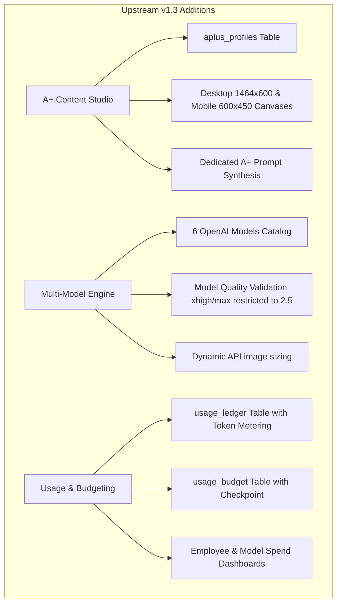
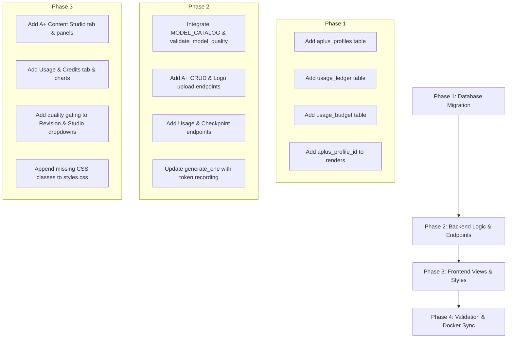

# StudioFlow Feature & Architectural Audit Report: Upstream v1.3 vs. Current Production App

**Date:** November 2, 2026  
**Subject:** Comparative Audit between `Current App` (`c:\Users\famesht\Documents\Apps\StudioFlow`) and `New StudioFlow v1.3` (`c:\Users\famesht\Documents\Apps\StudioFlow\References\New StudioFlow`).

---

## 1. Executive Summary

The upstream reference directory `References/New StudioFlow` represents **StudioFlow Version 1.3** (tagged 2026-11-02). It introduces three major enterprise operational capabilities:

1. **Dedicated Amazon Premium A+ Content Studio:** Full support for desktop (`1464x600`) and mobile (`600x450`) banner background creation with independent brand memory profiles, typography rules, color palettes, and logo references.
2. **Multi-Model Image Engine with Quality Guardrails:** Expansion to 6 OpenAI image models (`gpt-image-2.5-flare`, `gpt-image-2.5-sunburst`, `gpt-image-2`, `gpt-image-1.5`, `gpt-image-1-mini`, `chatgpt-image-latest`) with model-specific quality gating (preventing invalid `xhigh`/`max` requests on legacy models).
3. **Usage Ledger, Token Metering & Prepaid Recharge Checkpoint:** Granular per-request token tracking (`image_input`, `text_input`, `output`), estimated USD spend based on per-million rates, breakdown by employee/model, and a manual prepaid balance checkpoint to alert teams before OpenAI account credits run dry.

### Critical Finding on Codebase Divergence
While `New StudioFlow` (v1.3) contains these new frontend and API modules, **our current app possesses several critical architectural upgrades and business features that v1.3 lacks completely**:
- **13-Column Product Catalog CSV Feed (`catalog_products`)**
- **Smart Image Filename Matching (Auto-detecting ASIN, SKU, Item Code)**
- **Persistent SQLite Session Storage (`sessions` table)** — prevents user logouts across server restarts (v1.3 relies on volatile RAM `SESSIONS = {}`).
- **Clean Modular Python Architecture (`studioflow/` package)** — rather than a single monolithic script.
- **Docker Production Deployment Infrastructure (`Dockerfile`, `docker-compose.yml`, `.dockerignore`)**.

> [!IMPORTANT]
> **Do not replace the current app with `References/New StudioFlow`.** Doing so would erase the Product Catalog Feed, Smart Filename Matching, Docker containers, and Persistent Auth. Instead, the upstream v1.3 features should be selectively merged into our structured architecture.

---

## 2. Detailed Gap Analysis: What Upstream v1.3 Has That Our App Lacks



### Feature 1: Dedicated Amazon Premium A+ Content Studio

In our current app, generation is split into `lifestyle`, `main`, and `infographic`. v1.3 adds a 4th dedicated modality: `aplus`.

#### A. Database Schema
- **New Table `aplus_profiles`**:
  ```sql
  CREATE TABLE IF NOT EXISTS aplus_profiles (
    id TEXT PRIMARY KEY,
    name TEXT NOT NULL COLLATE NOCASE UNIQUE,
    master_instructions TEXT NOT NULL DEFAULT '',
    branding_notes TEXT NOT NULL DEFAULT '',
    heading_font TEXT NOT NULL DEFAULT 'Cinzel',
    body_font TEXT NOT NULL DEFAULT 'Roboto',
    primary_color TEXT NOT NULL DEFAULT '#283F44',
    secondary_color TEXT NOT NULL DEFAULT '#F4E7D9',
    accent_color TEXT NOT NULL DEFAULT '#9E7655',
    logo_file TEXT NOT NULL DEFAULT '',
    updated_at TEXT,
    updated_by TEXT
  );
  ```
- **New Column in `renders`**:
  - `aplus_profile_id TEXT DEFAULT ''` (persists which A+ profile guided the banner generation).

#### B. API Endpoints
- `GET /api/aplus/profiles`: Lists all saved A+ brand profiles, permission flags, and default master instructions.
- `POST /api/aplus/profiles`: Owner creates a brand profile with color hex validation (`HEX_RE`).
- `PUT /api/aplus/profiles/{pid}`: Owner updates instructions, typography, and color palette.
- `POST /api/aplus/profiles/{pid}/logo`: Uploads reference logo (saved to `data/brand_logos`).
- `GET /api/aplus/profiles/{pid}/logo`: Serves logo securely.

#### C. Prompt Injection & Task Rules
- **Task Rule**:
  ```python
  TASK_RULES['aplus'] = (
      'Amazon Premium A+ content banner background. Preserve exact product. '
      'Compose for desktop/mobile crop-safe space and brand style. '
      'NO rendered text, numbers, logos or divider lines: add approved copy '
      'and branding precisely after generation. Do not show children.'
  )
  ```
- **Prompt Branch in `make_prompt()`**:
  Injects heading/body fonts, color hexes, branding notes, and master instructions without conflicting with standard product memory.

#### D. User Interface
- Navigation item: **A+ Content Studio** (`#nav-aplus`).
- View (`#aplus-view`) with 3 structured production panels:
  1. Profile selector, font pickers, palette hex inputs, and logo uploader.
  2. Multi-product upload (up to 10 products with per-item SKU assignment).
  3. Custom scenes textarea (1 line = 1 banner background per uploaded product), batch prompt modifier, canvas size toggle (Desktop `1464x600` vs. Mobile `600x450`), and auto-calculated expected output counter.

---

### Feature 2: 6-Model Catalog & Quality Enforcement

In our current app, model selection is limited or defaults to a single entry. v1.3 implements a managed model catalog with rate-card metrics and server-side validation.

#### A. Model Catalog Definition
```python
MODEL_CATALOG = {
    'gpt-image-2.5-flare': {
        'label': 'GPT Image 2.5 Flare · fast bulk',
        'max_quality': 'max',
        'rates': (8, 5, 30) # ($/M tokens: image input, text input, output)
    },
    'gpt-image-2.5-sunburst': {
        'label': 'GPT Image 2.5 Sunburst · precision',
        'max_quality': 'max',
        'rates': (8, 5, 30)
    },
    'gpt-image-2': {
        'label': 'GPT Image 2 · previous generation',
        'max_quality': 'high',
        'rates': (8, 5, 30)
    },
    'gpt-image-1.5': {
        'label': 'GPT Image 1.5 · legacy',
        'max_quality': 'high',
        'rates': (8, 5, 32)
    },
    'gpt-image-1-mini': {
        'label': 'GPT Image 1 Mini · lower cost',
        'max_quality': 'high',
        'rates': (2.5, 2, 8)
    },
    'chatgpt-image-latest': {
        'label': 'ChatGPT Image Latest · alternative',
        'max_quality': 'high',
        'rates': (8, 5, 32)
    }
}
```

#### B. Quality Guardrails
- Legacy models (`gpt-image-2`, `gpt-image-1.5`, `gpt-image-1-mini`, `chatgpt-image-latest`) only support `low`, `medium`, and `high`.
- `xhigh` and `max` are restricted exclusively to `gpt-image-2.5-*`.
- The frontend dynamically disables `xhigh` and `max` options in select boxes whenever a non-2.5 model is active, and server-side `validate_model_quality(model, quality)` rejects invalid combinations with HTTP 400.
- `api_image_size(model, canvas)` dynamically adjusts API sizes for 2.5 vs. legacy architectures.

---

### Feature 3: Usage Ledger, Token Metering & Spend Tracking

v1.3 introduces real-time token tracking directly extracted from OpenAI Image API edit responses.

#### A. Database Schema
- **New Table `usage_ledger`**:
  ```sql
  CREATE TABLE IF NOT EXISTS usage_ledger (
    render_id TEXT PRIMARY KEY,
    job_id TEXT,
    user TEXT,
    model TEXT,
    kind TEXT,
    image_input_tokens INTEGER,
    text_input_tokens INTEGER,
    output_tokens INTEGER,
    cost_usd REAL,
    meter_status TEXT NOT NULL, -- 'reported' or 'unreported'
    created_at TEXT
  );
  ```

#### B. API Response Parsing (`generate_one`)
```python
usage = getattr(response, 'usage', None)
tokens = usage.model_dump() if hasattr(usage, 'model_dump') else (usage if isinstance(usage, dict) else None)
if tokens:
    detail = tokens.get('input_tokens_details') or {}
    image_in = int(detail.get('image_tokens') or 0)
    text_in = int(detail.get('text_tokens') or 0)
    out = int(tokens.get('output_tokens') or 0)
    in_all = int(tokens.get('input_tokens') or 0)
    if in_all and not image_in and not text_in:
        image_in = in_all
    rates = MODEL_CATALOG[model]['rates']
    amount = (image_in * rates[0] + text_in * rates[1] + out * rates[2]) / 1_000_000
    record = (image_in, text_in, out, amount, 'reported')
else:
    record = (None, None, None, None, 'unreported')
```

#### C. Spend Aggregations (`GET /api/usage`)
Returns:
- Total image input tokens, text input tokens, and output tokens.
- Total requests and count of requests that lacked token reporting.
- Grouped spend and request counts by **employee** (`by_user`).
- Grouped spend and request counts by **model** (`by_model`).

---

### Feature 4: Prepaid Balance Checkpoint & Recharge Warning

OpenAI's Image API does not provide a programmatic balance lookup endpoint. v1.3 implements an operational **Prepaid Balance Checkpoint**:

#### A. Database Schema
```sql
CREATE TABLE IF NOT EXISTS usage_budget (
  id INTEGER PRIMARY KEY CHECK(id = 1),
  balance_checkpoint_usd REAL NOT NULL DEFAULT 0,
  spend_at_checkpoint_usd REAL NOT NULL DEFAULT 0,
  alert_percent INTEGER NOT NULL DEFAULT 20,
  updated_at TEXT,
  updated_by TEXT
);
```

#### B. Operational Workflow
1. The account owner logs into the OpenAI Billing Dashboard and notes the prepaid credit balance (e.g. `$150.00`).
2. The owner saves this amount and an alert percentage (e.g. `20%`) via `PUT /api/usage/checkpoint`.
3. StudioFlow records the baseline spend at that moment. Subsequent image generation deductions are calculated from reported tokens.
4. If estimated remaining credits drop below the threshold (e.g., `< $30.00`), the dashboard banner turns orange, and a prominent recharge warning is displayed to the team.

---

## 3. Comparative Matrix: Current App vs. Upstream v1.3

| Capability / Module | Current Production App | Upstream v1.3 Reference | Impact / Verdict |
| :--- | :---: | :---: | :--- |
| **Product Catalog Feed (13 Columns)** | ✅ Full CSV import/export | ❌ Absent | **Keep Current:** Essential for user's ASIN/Bullet workflow. |
| **Smart Filename Matching** | ✅ Auto-matches images to SKU | ❌ Absent | **Keep Current:** Automatic SKU matching saves manual entry. |
| **Persistent SQLite Sessions** | ✅ Survives server restarts | ❌ RAM-only (`SESSIONS={}`) | **Keep Current:** Volatile RAM sessions force unwanted re-logins. |
| **Docker & Orchestration** | ✅ Dockerfile & compose | ❌ Batch scripts only | **Keep Current:** Required for server deployments (`mvserver`). |
| **A+ Content Studio** | ❌ Missing | ✅ Dedicated UI & DB | **Port from v1.3:** Major functionality addition. |
| **6-Model Catalog & Gating** | ❌ Hardcoded / Basic | ✅ 6 models + quality check | **Port from v1.3:** Prevents API 400 errors from OpenAI. |
| **Usage Ledger & Token Metering** | ❌ No token ledger | ✅ Tokens + USD calculated | **Port from v1.3:** Critical for team cost oversight. |
| **Balance Checkpoint & Alert** | ❌ Missing | ✅ Checkpoint + % bar | **Port from v1.3:** Prevents surprise API quota exhaustion. |
| **Codebase Structure** | ✅ Modular (`studioflow/`) | ⚠️ Single 799-line script | **Refactor during merge:** Keep modular architecture. |

---

## 4. Recommended Integration Plan

To bring the current app up to full parity with v1.3 **without losing any of our custom features**, follow this 4-phase integration roadmap:



### Phase 1: Database Migration (`studioflow/database.py` or `app.py`)
- Add schema creation for `aplus_profiles`, `usage_ledger`, and `usage_budget`.
- Add conditional column migrations: `aplus_profile_id` on table `renders`.

### Phase 2: Backend Logic & Endpoints (`app.py`)
- Import `MODEL_CATALOG` and helper functions `validate_model_quality()` and `api_image_size()`.
- Implement A+ CRUD routes (`/api/aplus/profiles`, `/api/aplus/profiles/{pid}`, `/api/aplus/profiles/{pid}/logo`).
- Implement Usage routes (`/api/usage`, `/api/usage/checkpoint`).
- In `generate_one()`, read `response.usage`, compute USD cost from `MODEL_CATALOG` rates, and insert into `usage_ledger`.
- In `make_prompt()`, add the `kind == 'aplus'` branch.

### Phase 3: Frontend UI (`static/index.html`, `static/app.js`, `static/styles.css`)
- **`index.html`**:
  - Add navigation items: `<button id="nav-aplus">` and `<button id="nav-usage">`.
  - Add `<section id="aplus-view">` and `<section id="usage-view">`.
  - Populate model dropdowns in standard generation, A+ generation, and revision modal with the 6 models.
- **`app.js`**:
  - Add navigation switching for `aplus` and `usage`.
  - Add A+ profile handling, multi-file SKU inputs, scene calculation, and submit.
  - Add Usage polling, metric rendering, balance calculation, and checkpoint submission.
  - Implement dynamic disabling of `xhigh`/`max` when non-2.5 models are selected.
- **`styles.css`**:
  - Append the ~40 lines of CSS classes (`.aplus-photo-line`, `.usage-metrics`, `.usage-balance`, `.big-percent`, `.big-progress`, `.usage-table`, `.usage-table-row`).

### Phase 4: Local Test & Docker Verification
- Run tests to verify existing CSV catalog features and smart filename matching remain 100% operational alongside the new A+ studio and usage dashboards.
- Verify startup under both local Uvicorn and Docker container.
