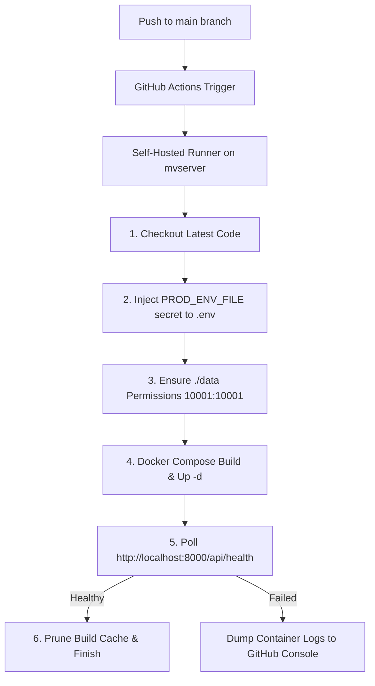

# StudioFlow Self-Hosted GitHub Actions Runner & Auto-Deploy Setup (mvserver)

This guide walks you through registering a dedicated GitHub Actions Self-Hosted Runner on **`mvserver`** and configuring continuous automated deployment for **StudioFlow**.

---

## 1. Overview & Architecture

Whenever you push to the `main` branch or trigger the workflow manually from GitHub:



- **Runner Directory on `mvserver`:** `~/actions-runner-studioflow` (separated from Monday-View).
- **Service Management:** Configured via Linux `systemd` daemon (`./svc.sh`) for 24/7 background uptime and auto-restart on server reboot.
- **Data Persistence:** Host volume `./data` (`studio.sqlite3`, uploaded photos, brand logos, output renders) persists untouched across rebuilds.

---

## 2. Setting Up the Runner on `mvserver`

Log into **`mvserver`** via SSH or open a terminal:

### Step 2.1: Create Dedicated Folder & Download Runner
```bash
# 1. Create a dedicated directory for StudioFlow
mkdir -p ~/actions-runner-studioflow && cd ~/actions-runner-studioflow

# 2. Download the GitHub Actions runner package
curl -o actions-runner-linux-x64-2.338.2.tar.gz -L https://github.com/actions/runner/releases/download/v2.338.2/actions-runner-linux-x64-2.338.2.tar.gz

# 3. Extract the archive
tar xzf ./actions-runner-linux-x64-2.338.2.tar.gz
```

### Step 2.2: Configure the Runner
```bash
./config.sh --url https://github.com/Fameshdthakre/StudioFlow --token BPKVMRHRB6FKTXSBNDNTPD3K5GBL6
```

> [!NOTE]
> GitHub runner registration tokens expire after 1 hour. If this token has expired, get a fresh token from:
> **GitHub Repo** > **Settings** > **Actions** > **Runners** > **New self-hosted runner**.

**Configuration prompts:**
- **Runner name:** `mvserver-studioflow` (or press `Enter` for default hostname)
- **Additional labels:** Press `Enter` (uses default: `self-hosted,Linux,X64`)
- **Work folder:** Press `Enter` (uses default: `_work`)

### Step 2.3: Install as a System Background Service
Do **not** use `./run.sh` (which terminates when you close your SSH session). Instead, install it as a Linux system service:

```bash
sudo ./svc.sh install
sudo ./svc.sh start
```

Verify the service status:
```bash
sudo ./svc.sh status
```

---

## 3. Configure GitHub Secrets (`PROD_ENV_FILE`)

Before running your first deployment, supply your production environment configuration to GitHub:

1. Go to your repository: [https://github.com/Fameshdthakre/StudioFlow/settings/secrets/actions](https://github.com/Fameshdthakre/StudioFlow/settings/secrets/actions)
2. Click **New repository secret**.
3. Set **Name:** `PROD_ENV_FILE`
4. Set **Secret:**
   ```ini
   APP_MODE=live
   COOKIE_SECURE=0
   MAX_WORKERS=3
   ALLOW_ANONYMOUS_DEMO=0
   STUDIOFLOW_BIND_ADDRESS=0.0.0.0
   TEAM_USERS=owner:password123
   ADMIN_USERS=owner
   STUDIOFLOW_ENABLE_APLUS=1
   STUDIOFLOW_ENABLE_USAGE=1
   OPENAI_API_KEY=your_secret_openai_api_key
   ```
5. Click **Add secret**.

*(When running in live mode, replace `OPENAI_API_KEY` with your actual OpenAI API key).*

---

## 4. Verifying in GitHub

1. Open: [https://github.com/Fameshdthakre/StudioFlow/settings/actions/runners](https://github.com/Fameshdthakre/StudioFlow/settings/actions/runners)
2. Verify **`mvserver-studioflow`** appears with a **green dot** and status **Idle**.

---

## 5. Triggering & Monitoring Deployment

### Automatic Trigger
Every `git push` to branch `main` that touches application code automatically starts the deployment workflow.

### Manual Trigger
1. Go to **Actions** tab on GitHub: [https://github.com/Fameshdthakre/StudioFlow/actions](https://github.com/Fameshdthakre/StudioFlow/actions)
2. Select **Deploy StudioFlow (Self-Hosted mvserver)** in the left sidebar.
3. Click **Run workflow** > select branch `main` > click **Run workflow**.

---

## 6. Runner Maintenance & Troubleshooting on `mvserver`

| Action | Command on `mvserver` |
| :--- | :--- |
| **Check Runner Status** | `cd ~/actions-runner-studioflow && sudo ./svc.sh status` |
| **Stop Runner Service** | `cd ~/actions-runner-studioflow && sudo ./svc.sh stop` |
| **Restart Runner Service**| `cd ~/actions-runner-studioflow && sudo ./svc.sh start` |
| **Uninstall Runner Service**| `cd ~/actions-runner-studioflow && sudo ./svc.sh uninstall` |
| **View Docker Container Logs** | `docker compose logs -f studioflow` |
| **Check Running Containers** | `docker compose ps` |
