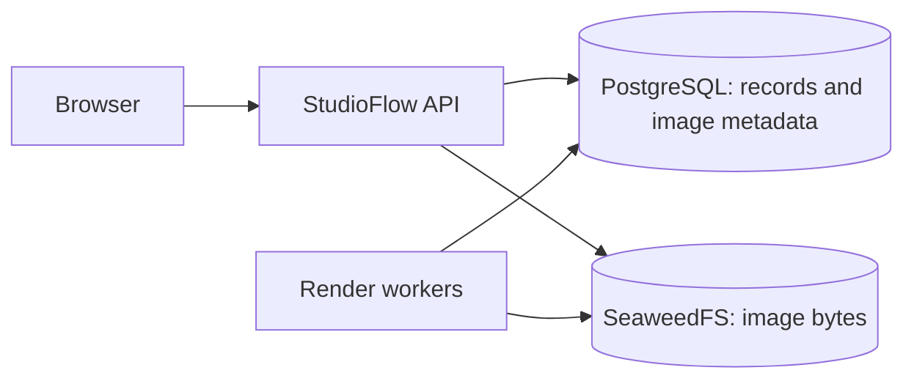

# StudioFlow relational data and image storage plan

## 1. Target architecture

Use **PostgreSQL 18 for structured records** and **SeaweedFS for private S3-compatible image storage**, both hosted on mvserver. SeaweedFS documents support for single-node production deployments. [PostgreSQL support policy](https://www.postgresql.org/support/versioning/), [SeaweedFS documentation](https://github.com/seaweedfs/seaweedfs)

The agreed defaults are:

- One shared internal workspace, targeting approximately 20 active users and 100,000 images.
- Docker runs the same application, database, and object-storage stack locally and in production.
- Storage improvements come first; the existing screens and workflows continue.
- Migration uses a planned maintenance window.
- Linked images are retained.
- Daily backups target recovery with at most one day of lost work. An off-server destination and successful restore test are required before production cutover.

## 2. Relational data design

Introduce **SQLAlchemy Core with psycopg and Alembic migrations**, keeping database transactions inside feature repositories used by the existing services. PostgreSQL is the supported runtime database; SQLite remains an import source for existing installations. SQLAlchemy provides the foundation for additional SQL adapters later. [SQLAlchemy dialects](https://docs.sqlalchemy.org/en/21/dialects/)

| Area | Planned relationships and rules |
|---|---|
| Products | Give every product a stable internal ID. Catalog information, manual memory, rules, and brand assignments reference that ID. |
| Identifiers | Keep canonical SKU unique. Preserve SKU-first matching and reject ambiguous ASIN/item-code matches. |
| Jobs and renders | Enforce job, product, parent revision, and image-asset foreign keys. Preserve existing public IDs. |
| Users and history | Store stable user identities for ownership and auditing; retain historical identities when accounts are removed. Existing credential configuration continues to control authentication. |
| Usage and submissions | Preserve immutable usage receipts, integer microdollar amounts, rate-card snapshots, and unique submission keys. |
| Images | Store metadata and relationships in an `assets` table; store image bytes in object storage. |

Additional rules:

- Archive catalog entries without cascading deletion into product memory, renders, images, or accounting history.
- Keep accepted prompt/profile snapshots immutable, with explicit references to any snapshot-associated images.
- Add indexes for product identity, foreign keys, queue status/order, revision history, and usage reporting.
- Replace SQLite-specific queue locking with PostgreSQL row locking using `FOR UPDATE SKIP LOCKED`. Add an explicit enqueue sequence to preserve ordering.
- Serialize submissions and budget checkpoints through a shared transaction lock, preserving capacity checks and checkpoint boundaries.
- Use repeatable-read transactions when capturing prompt snapshots. Retry database serialization failures only around database work.

## 3. Image objects and application interfaces

Create a storage interface with `put`, `open`, `stat`, and `delete` operations, implemented through an S3 client.

Each asset records:

- Asset ID, bucket, immutable object key, and lifecycle state.
- Image role: normalized source, generated output, logo, or thumbnail.
- MIME type, byte size, dimensions, SHA-256 checksum, uploader, and creation time.
- References from products, renders, profiles, and historical snapshots.

Use generated object keys without product names or user-supplied paths. Replacing a logo or producing a revision creates a new asset.

**Upload and publication flow**

1. Validate images using the existing format, size, and normalization rules.
2. Reserve the submission and pending asset records.
3. Upload outside database transactions.
4. Confirm the objects and atomically commit ready assets, render relationships, and the submission response.

A per-submission PostgreSQL advisory lock coordinates concurrent retries. A durable reservation lets interrupted requests resume without creating another job.

For generated outputs, persist the provider receipt and generated file before uploading to object storage. Durable transfer tasks may retry an existing file upload; they must never repeat a paid provider request automatically. Publish a completed render only after its output asset is ready.

**Interfaces**

- Add `DATABASE_URL` and S3 endpoint, region, bucket, and credential settings.
- Preserve current API routes, IDs, download URLs, authentication, and response fields.
- Serve private images through authenticated application routes.
- Add `thumbnail_url` to gallery records and generate 512-pixel WebP thumbnails for output previews.
- Add operator commands for storage audit, migration dry-run/apply, backup, restore verification, and orphan cleanup dry-run/apply.

## 4. Migration, deployment, and backups

**Prepare before switching**

- Inventory records and files; report duplicate identifiers, broken relationships, missing images, and required disk capacity.
- Block migration on unresolved integrity errors.
- Add a maintenance gate that pauses mutations and new worker claims while active work drains.
- Deploy PostgreSQL and SeaweedFS independently of application replacements. Keep their ports private and pin tested container images by digest.
- Use separate persistent directories for PostgreSQL, object storage, and application staging. Apply service-specific ownership rather than recursively assigning everything to the application UID.

**Migrate during maintenance**

- Back up the complete existing workspace.
- Copy SQLite records into PostgreSQL, preserving public IDs, ordering, sessions, snapshots, receipts, and ledger sequence boundaries.
- Upload existing images using deterministic migration mappings; verify downloaded bytes against source checksums.
- Make migration resumable and verify row counts, relationships, accounting totals, and referenced assets before switching configuration.
- Resume writes only after verification. Retain the original workspace for recovery; after new writes begin, recovery must reconcile them before reverting storage.

**Backup and retention**

- Schedule backups daily at **03:00 Asia/Kolkata**.
- Briefly pause writers and drain active work to capture a consistent PostgreSQL dump and object manifest. Resume service while immutable objects are streamed into an encrypted Restic backup.
- Suspend garbage collection until the backup completes. Avoid copying live PostgreSQL database files directly. [PostgreSQL backup documentation](https://www.postgresql.org/docs/18/backup-dump.html)
- Retain seven daily, four weekly, and three monthly backups.
- Keep all linked source images, outputs, revisions, and logos. Automatically clean only abandoned uploads older than seven days after confirming they have no active submission, render, profile, snapshot, or transfer reference.
- Report backup failures, missing objects, failed transfers, low disk space, and backups older than 24 hours.

Because no off-server destination exists yet, backup tooling can be prepared and rehearsed locally, but production cutover remains gated on an external copy and restore verification.

## 5. Acceptance tests and rollout gates

- Run the existing API and browser regressions against PostgreSQL.
- Test real PostgreSQL and SeaweedFS containers in CI, including restart persistence and private image delivery.
- Verify migration preserves catalog facts, manual memory, revisions, approvals, sessions, usage totals, and submission replay behavior.
- Inject failures between object upload and database commit, during output transfer, and after a provider response. Confirm recovery cannot duplicate paid work.
- Confirm orphan cleanup preserves every referenced asset.
- Restore a backup into a fresh stack and verify records, checksums, image access, and queued-work recovery.
- Seed 100,000 asset records and exercise indexed queries with concurrent queue workers.
- Require a clean migration rehearsal, sufficient host capacity, and a verified off-server backup before the production switch.

Implementation order: **maintenance and audit tooling → relational repositories and schema → asset storage integration → migration rehearsal → backup restore verification → production cutover**.
